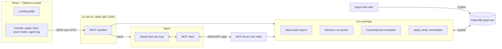
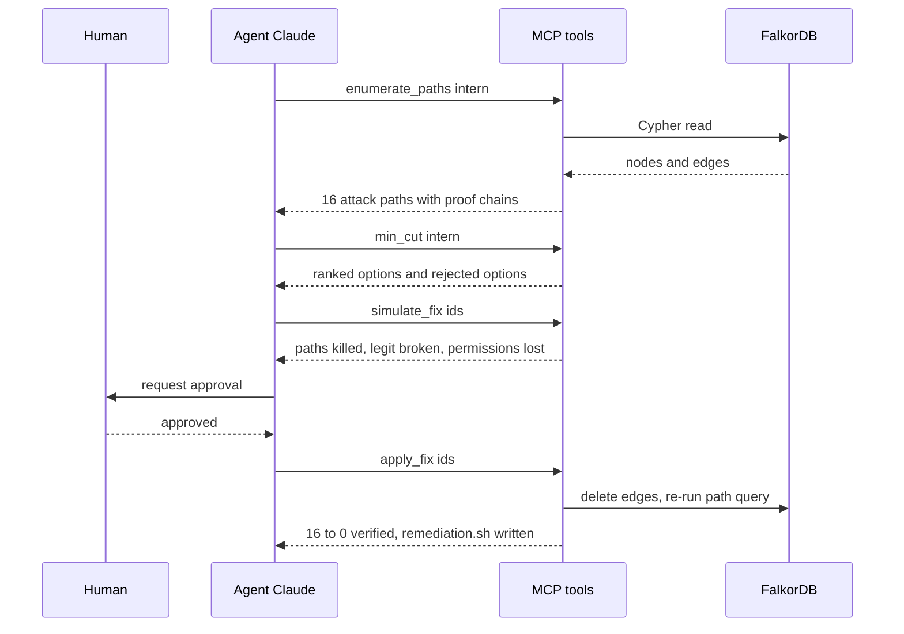
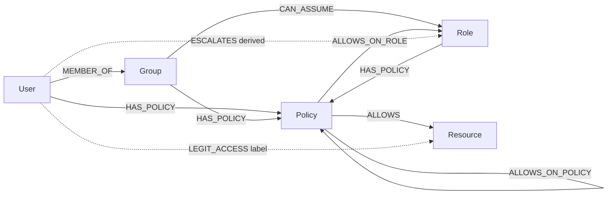

# ⛓ Chokepoint

**Find the path. Cut the path. Prove it.**

Chokepoint is an AI agent that maps cloud IAM as a graph in **FalkorDB**, finds every multi-hop attack path from an identity to your crown jewels, computes the **smallest set of permissions to remove**, checks that legit access survives, applies the fix after human approval, and **verifies from the graph** that the paths are gone.

> Built for **Graph Hacks** (WeMakeDevs × FalkorDB) · **Track 01: Agents That Act on Connected Data**

**Demo video:** `<add your video link here>` · **Blog post:** `<add your blog link here>`

<!-- Add three screenshots to docs/ and these will render:


-->

---

## The problem

Security tools give you a flat list of findings. Cloud IAM is a web of groups, roles, policies and trust relationships: every permission looks harmless alone, but chained together a junior account can launch a machine with an admin role, or quietly rewrite its own policy.

Teams don't fix these because the fix feels risky: _"what if it breaks something?"_ Chokepoint answers that **before** it touches anything.

## What it does, on the bundled demo data

The demo graph has **88 nodes** (16 users, 11 groups, 14 roles, 25 policies, 22 resources, 6 of them crown jewels). One user, `intern`, was left in four groups and has a risky direct policy.

|                                                               |                                                                                                |
| ------------------------------------------------------------- | ---------------------------------------------------------------------------------------------- |
| Attack paths from `intern` to crown jewels                    | **16** (all 6 crown jewels reachable)                                                          |
| Minimum cut                                                   | **4 permission edges**, found exactly in < 100 ms over 29 candidate permissions                |
| Best fix                                                      | remove `intern` from `developers`, `contractors`, `data-team` and detach `InternSandboxPolicy` |
| Permissions lost by other users                               | **0**                                                                                          |
| After applying (re-queried from the graph)                    | **16 → 0** attack paths                                                                        |
| A tempting alternative (detach `DevPolicy` from `developers`) | also contains `intern`, but costs **21** permissions of other developers                       |
| Fixes the guard rejects                                       | anything that breaks labeled legit access, e.g. `data-eve → kms-keys`                          |

All numbers come from real runs against FalkorDB, not from the model.

---

## Architecture



**One implementation, three front doors.** The web API, the MCP server and the CLI all call the same `core` package, so the number you see in the UI, the number the agent reports and the number in a test are the same code path.

### Agent loop



The agent never writes Cypher. It **selects among MCP tools**; every tool runs against the graph, and the final report may only use numbers the tools returned.

### Graph data model



- `ALLOWS` points at a resource and is directly walkable.
- `ALLOWS_ON_ROLE` / `ALLOWS_ON_POLICY` (for example `iam:PassRole`, `iam:CreatePolicyVersion`) are **not** access paths on their own. They only matter in combination, which is what the privilege-escalation rules below detect.
- `ESCALATES` is a **derived edge** created by Cypher rules. It stores a `via` list: the real permission edges it depends on.
- `LEGIT_ACCESS` is the labeled ground truth of access that must keep working.

### Privilege-escalation rules (derived edges)

| Rule                      | Needs (all of them)                                                     | Result                                       |
| ------------------------- | ----------------------------------------------------------------------- | -------------------------------------------- |
| `passrole_runinstances`   | `iam:PassRole` on role R + `ec2:RunInstances`                           | become R                                     |
| `passrole_lambda`         | `iam:PassRole` on R + `lambda:CreateFunction` + `lambda:InvokeFunction` | run code as R                                |
| `passrole_cloudformation` | `iam:PassRole` on R + `cloudformation:CreateStack`                      | deploy a stack as R                          |
| `updateassumerolepolicy`  | `iam:UpdateAssumeRolePolicy` on R                                       | trust yourself, become R                     |
| `createpolicyversion`     | `iam:CreatePolicyVersion` on a policy attached to you                   | rewrite it to `*:*`, reach every crown jewel |

---

## How the minimum cut works

A privilege escalation is an **AND** of permissions (for example `PassRole` _and_ `RunInstances`). Plain max-flow/min-cut cannot model AND-edges, so Chokepoint does an **exact search** instead:

1. Enumerate all attack paths (multi-hop traversal) and record, for every path, the real permission edges it depends on (expanding each `ESCALATES` edge through its `via` list).
2. Each candidate edge gets a **bitset of the paths it kills**.
3. Search cut sizes 1, 2, 3 … and only run the expensive evaluation on edge sets that already cover every path.
4. Evaluation re-walks the graph with those edges removed and reports: crown jewels still reachable, **legit access broken**, and **permissions lost by other users** (the attacker's own lost access is the goal, not collateral).
5. Cuts that break labeled legit access are **rejected**. The rest are ranked by least collateral, then by how close they are to the attacker (root cause first). Equivalent variants are grouped.

FalkorDB has no built-in min-cut, so the search runs in Go over the graph loaded from FalkorDB. The traversals, the derived edges, the mutation and the final verification are all Cypher.

---

## Track 01 mapping

| Key focus                                   | Where                                                                                                |
| ------------------------------------------- | ---------------------------------------------------------------------------------------------------- |
| Multi-hop reasoning                         | variable-length Cypher traversal; proof chains of up to 4 hops per path                              |
| Graph queries and algorithms as agent tools | `enumerate_paths`, exact `min_cut`, counterfactual `simulate_fix`                                    |
| Tool selection through MCP                  | stdio MCP server; the agent discovers tools with `tools/list` and picks them itself                  |
| Actions based on what the graph shows       | `apply_fix` deletes edges, writes `out/remediation.sh` with `aws iam` commands; refuses unsafe fixes |
| Explainable results                         | every path is a chain of real edges with their ids; every rejection says exactly what it would break |

### MCP tools

| Tool              | What it does                                                                                                                                           |
| ----------------- | ------------------------------------------------------------------------------------------------------------------------------------------------------ |
| `list_identities` | users and crown jewels                                                                                                                                 |
| `enumerate_paths` | all attack paths from an identity, with permission edge ids                                                                                            |
| `min_cut`         | smallest legit-safe permission set, ranked options, rejected options                                                                                   |
| `simulate_fix`    | counterfactual for any set of edges; changes nothing                                                                                                   |
| `apply_fix`       | removes the edges, writes the remediation script, re-queries the graph to verify. Refuses if the attacker is not contained or legit access would break |

---

## Run it

Requirements: Docker, Go 1.22+, Node 20+, an Anthropic API key (only for the agent).

```bash
# 1. graph database (FalkorDB on 6379, Browser on 3000)
docker compose up -d

# 2. seed the demo IAM graph and derive the escalation edges
go mod tidy
go run ./ingest && go run ./rules

# 3. API server (CORS allows any localhost port by default)
export ANTHROPIC_API_KEY=sk-ant-...      # needed for "Run agent"
go run ./server                          # http://localhost:8080

# 4. web console
cd web && npm install && npm run dev     # http://localhost:5173
```

Open the console, pick `intern`, compare the options in the **Fixes** tab, then press **Run agent** or apply a fix yourself (human approval modal). **Reset graph** re-seeds the demo.

Other entry points:

```bash
go run ./mincut                 # min-cut report in the terminal
go run ./agent                  # terminal agent with a y/N approval prompt
go run ./mcp                    # stdio MCP server for any MCP client
go test ./...                   # core logic and CORS tests
```

### API

| Method | Path                                    |                                                |
| ------ | --------------------------------------- | ---------------------------------------------- |
| GET    | `/api/health`                           | graph reachable?                               |
| GET    | `/api/graph?source=intern`              | nodes, edges, attack paths (proof chains)      |
| GET    | `/api/mincut?source=intern`             | min-cut options and single-fix counterfactuals |
| GET    | `/api/simulate?source=intern&ids=e2,e3` | what-if impact of removing edges               |
| POST   | `/api/apply` `{source, ids}`            | safe apply, verify, `out/remediation.sh`       |
| GET    | `/api/remediation`                      | generated script                               |
| GET    | `/api/trace`                            | agent reasoning log                            |
| GET    | `/api/status`                           | is the agent running                           |
| POST   | `/api/run` `{source, task?}`            | start the agent (auto-approve)                 |
| POST   | `/api/reset`                            | re-seed the demo graph                         |

CORS: `go run ./server -cors dev` (default: any localhost port) · `-cors '*'` · `-cors https://your.app,http://localhost:5173`. Point the UI at another API with `VITE_API_URL` (see `web/.env.example`).

---

## Project structure

```
chokepoint/
├── docker-compose.yml        FalkorDB
├── data/
│   ├── iam.json              demo IAM: 88 nodes
│   └── legit.json            labeled legit access (ground truth for the guard)
├── ingest/                   JSON → graph (Cypher)
├── rules/                    5 privilege-escalation rules → ESCALATES edges
├── core/                     paths, exact min-cut, simulate, apply, remediation (+ tests)
├── mincut/                   CLI report
├── mcp/                      MCP server (stdio, JSON-RPC)
├── agent/                    Claude tool-use loop + MCP client + trace
├── server/                   JSON API with CORS (+ tests)
└── web/                      React + Vite + Tailwind console and landing page
```

---

## Honest limits

- **Explicit allow statements only.** No conditions, SCPs or permission boundaries. "0 paths" means none were found within the model, not that an identity is proven safe.
- **Five escalation patterns** are modeled. Real AWS has more.
- **"Legit access" is a labeled set** in `data/legit.json`. A real deployment would derive it from usage logs.
- **Exact search is sized for tens of candidate permissions** (29 in the demo, about 60 ms), not thousands.
- **Demo data is synthetic.** Nothing touches a real AWS account; remediation is generated as reviewable commands.
- A fix contains the chosen identity only. In the demo, `dev-alice` still has attack paths because `DevPolicy` itself can rewrite itself. Fixing a user and fixing a policy are different decisions.

---

## Tech

FalkorDB (Cypher, graph storage) · Go (core, API, MCP server, agent) · Model Context Protocol · Claude (tool-using agent) · React, Vite, Tailwind CSS, D3 (console).

Built for Graph Hacks by WeMakeDevs × FalkorDB.
